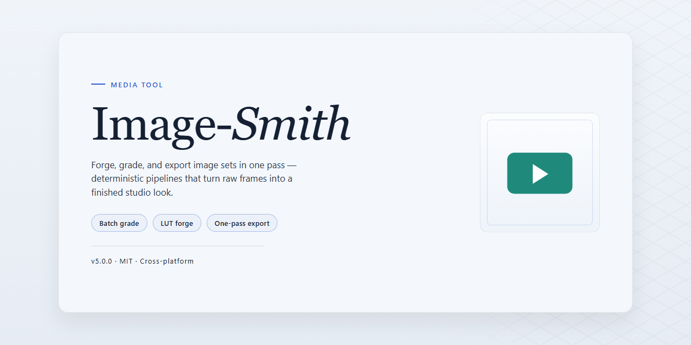

# 🖼️ Image-Smith: Creative Batch Image Workflow — Media Editor

### 📦 PowerShell Install Button

  

---

Image Smith turns a folder of raw shots into a polished, consistent set without the tedium of opening each file by hand. Queue up your images, then crop, rescale, correct color, and convert formats in a single pass while a live preview keeps every adjustment honest before you commit. The interface stays out of the way, so your attention remains on the frames themselves rather than the menus.

## 🔧 Requirements

- Windows 10 or Windows 11
- PowerShell 5.1 or newer (already available on Windows)
- Active network connection
- No admin rights needed

## Features

**A forge for your image pipeline.** Image Smith turns the tedious parts of image work — resizing, re-encoding, color tweaks — into a single fluid pass. Drop in a folder, shape the batch, watch it land.

**Batch at the speed of thought**
- Queue dozens or hundreds of images and let them move through one shared recipe.
- Chain operations — crop, scale, rotate — so each frame exits exactly as intended.
- Fire-and-forget processing means you set the recipe once and the whole set follows.

**Color that behaves like a dial, not a switch**
- Adjust contrast, saturation, and tone levels with live feedback.
- Reach for stylized looks like sepia and grayscale without leaving the batch.
- Preview the change on a single frame before committing it across the set.

**Crop and compose with intent**
- Define crop regions and apply them uniformly across mismatched sources.
- Rotate and reframe in the same pass as your color work.
- Drag-and-drop your images in — no menus to hunt through.

**Formats as a first-class citizen**
- Move between JPEG, TIFF, GIF, and PNG in bulk.
- Pick your output format per batch and let Image Smith handle the conversion.
- Keep the original pipeline intact while producing delivery-ready exports.

**A workspace that shows its work**
- A visual step-by-step flow keeps every operation in view.
- Preview before and after so nothing ships half-baked.
- An interface built for quick navigation, whether you're processing ten images or a thousand.

**Made for the Windows desktop**
- Runs natively on Windows, ready the moment you open it.
- Save your recipes and reuse them for the next batch.
- Regular updates keep the toolkit sharp.

## How It Works

Image Smith works like a visual assembly line for your photos — you line up the raw material, set the transformations once, and let the tool stamp out polished results across your entire collection.

**1. Load the Forge**
Drop a single image or a whole folder onto the workspace. Your files land as thumbnails in a contact sheet, giving you a bird's-eye view of everything queued for processing. No digging through menus, no adding files one by one.

**2. Shape the Recipe**
Build your transformation stack visually. Crop to a consistent aspect ratio, dial in color balance, shift brightness and contrast, apply a sepia wash, resize for the web, or convert between formats — each action stacks on top of the last like layers in a recipe. The order stays visible, and you can reorder or remove any step on the fly.

**3. Preview in Real Time**
The preview pane mirrors the exact output before anything is committed. See how a crop interacts with a color shift, or how a format conversion affects the final look. What you see is what gets baked in.

**4. Run the Batch**
One click sends the whole recipe across every image in the queue. Image Smith works through them in sequence, applying the same treatment with consistent, repeatable precision — no manual repetition, no drift between files.

**5. Collect and Save**
Finished images land in your output folder, formatted and ready. Reuse the same recipe for future batches, or tune it and run again. The workflow stays fast and predictable, whether you are processing five images or five hundred.

## Workflow

**Drop in your images.** Drag a folder onto the canvas or load individual files, and watch them assemble into a tidy grid of thumbnails. Every image lands as a visible card — a contact sheet of everything you're about to sculpt.

**Shape the batch.** Stack transformations like layers of a recipe: rescale dimensions, crop to a ratio, rotate for alignment, then tint with contrast or sepia. Each adjustment dances through the preview in real time, so what you see is exactly what gets written out.

**Preview the reveal.** Scrub through transformed results side-by-side before a single file is touched. Toggle comparisons, spot a crooked crop, tweak the color curve — the preview stage is your safety net and your playground in one.

**Apply and export.** One click sends your recipe across the entire set, converting formats between JPEG, TIFF, GIF, and PNG along the way. Save your configuration as a reusable preset, and the next batch becomes a two-step magic trick: load, apply, done.

**Iterate without friction.** Every run leaves your originals untouched, so experiments are always reversible. Tune the recipe, run it again, and refine until the whole set sings in unison.

## FAQ

**Is Image Smith really free — or is there a catch hiding in the fine print?**

No catch. The full toolkit is yours on Windows with no trial timers, no watermarks stamped across your exports, and no feature locked behind a paywall. What you see in the preview is what you ship.

**My folder has hundreds of mismatched photos. Where do I even begin?**

Think of Image Smith as a workbench, not a single-file editor. Drop an entire folder onto the workspace, let the thumbnails fan out like contact sheets, then treat the batch as one canvas — crop, recolor, resize, and convert them all in a single pass while the preview keeps your changes visible before anything is committed.

**Can I trust what I see before hitting apply?**

That's the whole point of the preview pane — it's your safety net. Dial in contrast, swap a format, or reframe a crop and watch the result update in real time. Nothing touches your originals until you're satisfied and press the button.

**Will it play nice with the formats already sitting on my drive?**

JPEG, TIFF, GIF, and PNG all flow through the same pipeline. Mix them in one batch and Image Smith sorts out the differences, so you're not juggling separate tools for every file type.

**What's the smartest way to slot this into my routine?**

Build a rhythm: organize source folders first, save your go-to adjustment presets, then run large batches overnight-style in one sweep. Repeatable settings turn a tedious chore into a two-click habit — and future work gets faster every time.

**Do I need anything else installed to get it running?**

Just a standard Windows setup with QuickTime present, since the tool leans on it for certain media handling. Confirm that's in place and you're ready to smith.

**Something's acting up — where do I turn?**

Start with the built-in preview and settings to rule out a quick fix, then check back for updates, which arrive regularly with refinements and new capabilities. If the issue persists, the project's own support channels are the place to raise it.

## License

Image Smith is built to stay out of your way, and the license follows the same philosophy: the full toolset is yours to use, with no locked doors, no watermarks stamped across your exports, and no feature held back behind a paywall. Fire up a batch on Windows, chain together color tweaks, crops, and format swaps, and ship the results wherever your workflow needs them — the license simply clears the path so the pixels can move freely.

Think of it as the frame around the canvas: it defines the edges without crowding the picture. You keep full control of your edits and your output, while the license keeps Image Smith's distribution consistent and predictable for every user who downloads it. No surprise clauses hiding in the fine print, no restrictions that force you to second-guess a creative decision mid-batch.

In practical terms, that means you can treat Image Smith as a dependable station in your pipeline — drop images in, run your preset workflow, collect the finished files, repeat. The license is designed to support exactly that rhythm: uninterrupted, repeatable, and free of friction, so the only thing you need to think about is the next image.